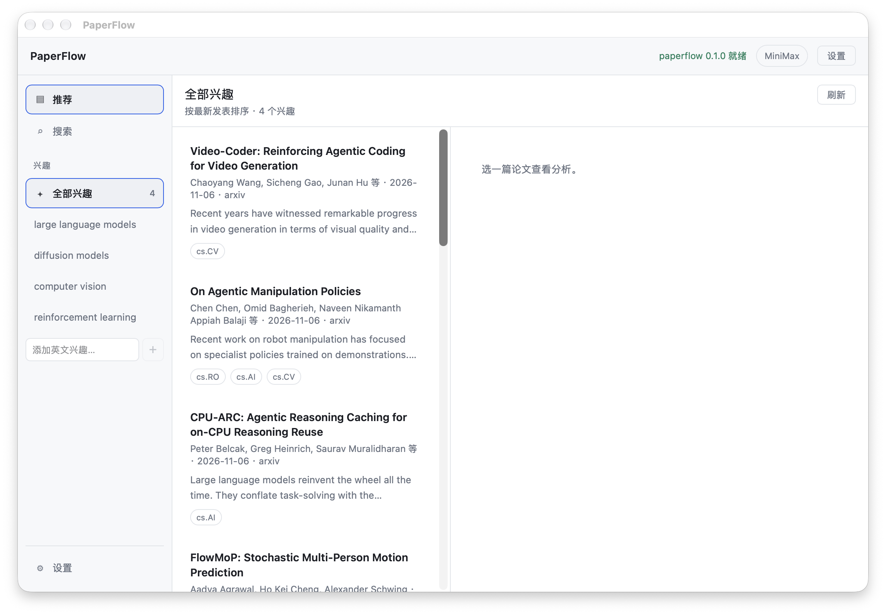

# PaperFlow

A desktop app for discovering and analyzing academic papers: arXiv / OpenAlex search, an interest-based feed, Chinese-to-English query translation, LLM summaries, a built-in PDF reader, and AI-assisted reading.

[简体中文](README.md) | English



## Features

- **Search**: natural-language search over arXiv / OpenAlex; Chinese queries are translated into English keywords by the LLM, and the query actually used is shown above the results
- **Interest feed**: browse the latest papers by interest, with a merged "all interests" channel and per-interest channels
- **LLM analysis**: streaming Chinese summaries (one-sentence / detailed analysis / key points)
- **PDF reader**: PDFs downloaded and cached by Rust, with paging, page jump, and zoom
- **AI reading assistant**: explain a selection, ask about the current page or the full paper, streaming output; the AI panel can be resized by dragging the divider
- **Selection translation**: translate selected PDF text into Chinese with one click; the translation is an independent card, copyable and cached for the session
- **Round-table review**: three personas (rigor / reproducibility / insight) review the paper independently and produce an aggregate verdict, with group-chat follow-ups and final opinions
- **Multi-provider LLM**: any OpenAI-compatible endpoint, switch between multiple profiles, API keys are write-only
- **Direct academic sources**: let arXiv / OpenAlex bypass the system proxy when the proxy exit is rate-limited

## Install (macOS)

Download the latest `.dmg` from [Releases](https://github.com/BoBoDai/PaperFlow/releases) and drag it into Applications.

The current build is ad-hoc signed and not notarized, so the first launch requires either:

- right-click `PaperFlow.app` → Open, or
- `xattr -dr com.apple.quarantine /Applications/PaperFlow.app`

Then open Settings and configure any OpenAI-compatible provider (DeepSeek / OpenAI / MiniMax / custom) to use the LLM features.

## Architecture

**Rust owns the domain logic, TypeScript owns the UI, and Tauri packages everything into a single app.**

```
┌─────────────────────────────────────────────┐
│  ui/           React + Vite                 │  render layer
└──────────────────┬──────────────────────────┘
                   │ Tauri IPC (no ports, no CORS, typed)
┌──────────────────▼──────────────────────────┐
│  src-tauri/    Tauri shell + IPC commands   │  shell: wiring only
└──────────────────┬──────────────────────────┘
┌──────────────────▼──────────────────────────┐
│  crates/usecases/   orchestration, no transport │  ← new transport = new shell
└──────────────────┬──────────────────────────┘
┌──────────────────▼──────────────────────────┐
│  crates/core/       pure logic, zero IO     │  unit-testable
│  crates/adapters/   the outside world       │  arXiv / OpenAlex / LLM / PDF
└─────────────────────────────────────────────┘
```

### Two rules we never break

1. **No `tauri::` or `axum::` inside `crates/usecases`.**
   Adding a web, CLI, or TUI front end later should cost a 5-line shell, not a refactor.

2. **LLM output must pass structural validation before it is returned — no "parse failed, use the raw text" fallback.**
   See `paperflow_core::Error::InvalidLlmOutput`. Silent degradation is the worst failure mode: users see garbage and the logs stay quiet.

## Documentation

- `CLAUDE.md`: commands, layering boundaries, task routing, project rules
- `docs/architecture.md`: full request paths for search / feed / summary / Q&A / PDF
- `docs/decisions.md`: settled decisions and rejected approaches — read before changing the architecture

## Layout

```
crates/
  core/         domain models + pure logic (Paper, Summary, Review, errors)
  adapters/     traits and implementations for arXiv / OpenAlex / LLM / PDF
  usecases/     orchestration layer, transport-agnostic
src-tauri/      Tauri app (main.rs is the entry, commands.rs is the IPC surface)
ui/             React + Vite front end
docs/           technical docs and screenshots
```

## Development

Prerequisites: Rust (with rustup), Node 20+, pnpm, Xcode Command Line Tools.

```bash
pnpm install          # installs the root (Tauri CLI) and ui/ dependencies
```

### Desktop app (full form)

```bash
pnpm app:dev          # start Tauri with HMR inside the window
pnpm app:build        # produce .dmg / .msi / .deb / .AppImage
```

### Front end only (fast UI iteration in a browser)

```bash
pnpm dev              # Vite only, open localhost:5173
```

Note: there is no Tauri IPC in a browser, so the UI shows "not running inside Tauri".
Use this for layout and styling; data requires `pnpm app:dev`.

### Checks

```bash
cargo test --workspace     # all Rust tests
cargo clippy --workspace --all-targets -- -D warnings
pnpm typecheck             # front-end type check
pnpm build                 # typecheck + vite build
```

## Feed and interests

The left sidebar has three entries: Feed, Search, and Interests. The feed shows the newest papers by interest:

- Default interests: `large language models`, `diffusion models`, `computer vision`, `reinforcement learning`
- "All interests" merges every interest; each interest also has its own channel
- Sorted newest first, with infinite scroll and a manual "load more"
- arXiv is the primary source; failure or an empty result falls back to OpenAlex; if both fail, the error is explicit
- Interests are edited in the sidebar, at most 8; English topics work best (the sources are English-language)
- Interests live in `localStorage` under `paperflow.interests.v1`, not in backend config

## Reading papers

Clicking a paper card generates an AI summary first; "Start reading" on the detail page opens the built-in PDF reader:

- PDFs are downloaded and cached by Rust (HTTPS only, public hosts, 32 MB cap, `%PDF-` validation) to avoid WebView CORS issues
- Paging, page jump, and zoom
- Select PDF text → "Explain selection" or "Translate"
- Q&A supports two scopes: current page and full paper; above roughly 40k characters the full text keeps the head and tail and reports that it was truncated
- Q&A and translation stream: Rust parses SSE and pushes deltas through a Tauri Channel
- Multi-turn follow-ups keep the latest 6 turns; answers are in Simplified Chinese
- The divider between the PDF and the AI panel is draggable and the width is remembered
- Scanned PDFs and publisher login/subscription pages produce an explicit error

The PDF.js worker, cmaps, and standard fonts are copied into `ui/dist/` at build time.

## Round-table review

Open the detail page and click "Round-table review". Three personas review the same paper independently:

- Rigor (RIGOR), reproducibility (REPRO), insight (INSIGHT)
- Each persona returns a stance, confidence, strengths, concerns, the riskiest claim, and what evidence would change its mind
- Results aggregate into consensus / majority / split / incomplete; abstract-only reviews cap confidence at 70
- Continue with "ask the panel" in group chat, then collect final opinions
- With a PDF available, "load full text and re-review"

## LLM configuration

The top-right Settings dialog has two pages: Model providers and Network.

- **Model providers**: manage multiple OpenAI-compatible providers on the left and edit the selected one on the right, grouped into provider / connection / model / advanced compatibility
- Presets: DeepSeek, OpenAI, MiniMax, custom
- "Set active" decides which provider is used for query translation, summaries, Q&A, and round-table review
- Saved immediately; no restart needed
- **Network**: route arXiv / OpenAlex around the system proxy; LLM requests and PDF downloads keep using the proxy

Settings live in the app config directory `settings.json` (on macOS,
`~/Library/Application Support/com.paperflow.desktop/`, mode 0600).
API keys are stored separately in `credentials.json`. Neither file enters the repository or the logs, and legacy config migrates automatically.

## Status

Implemented:

- [x] Real arXiv / OpenAlex clients (automatic fallback on rate limits and empty results)
- [x] Multi-provider LLM (streaming summaries / Q&A / translation / round-table review)
- [x] Interest-based feed
- [x] Built-in PDF reader + AI-assisted reading
- [x] Direct-connection switch for academic sources
