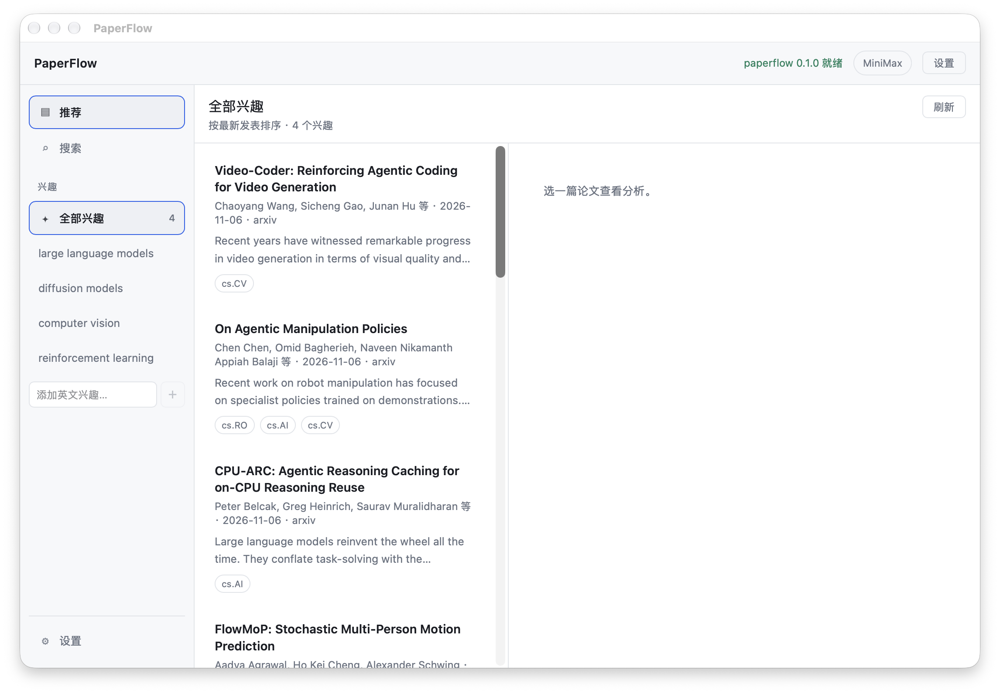

# PaperFlow

[English](README.en.md) | 简体中文

学术论文检索与分析桌面应用：arXiv / OpenAlex 检索、兴趣信息流、中文查询转英文关键词、LLM 摘要、内置 PDF 阅读器与 AI 问答。



## 功能

- **检索**：自然语言搜索 arXiv / OpenAlex；中文查询由 LLM 转英文关键词，结果上方显示实际使用的查询
- **兴趣信息流**：按兴趣浏览最新论文，支持「全部兴趣」合并频道与单个兴趣
- **LLM 分析**：流式生成中文摘要（一句话 / 详细分析 / 要点）
- **PDF 阅读器**：Rust 下载并缓存 PDF，支持翻页、页码跳转、缩放
- **AI 阅读助手**：选区解释、当前页 / 全文问答，流式输出；AI 面板可左右拖动调整宽度
- **选中翻译**：选中 PDF 文本一键翻译成中文，译文独立卡片、可复制、会话内缓存
- **圆桌评审**：三个人格（严谨性 / 可复现性 / 洞察力）独立评审并聚合结论，支持群聊追问与终局表态
- **多服务商 LLM**：任意 OpenAI 兼容端点，多套配置一键切换，API Key 只写不读
- **学术源直连**：代理出口被限流时，可让 arXiv / OpenAlex 绕过系统代理

## 下载安装（macOS）

从 [Releases](https://github.com/BoBoDai/PaperFlow/releases) 下载最新 `.dmg`，拖入「应用程序」。

当前构建为 ad-hoc 签名、未公证，首次打开需要：

- 右键 `PaperFlow.app` → 「打开」，或
- `xattr -dr com.apple.quarantine /Applications/PaperFlow.app`

首次启动后打开「设置」，配置任意 OpenAI 兼容服务商（DeepSeek / OpenAI / MiniMax / 自定义）即可使用 LLM 功能。

## 架构

**Rust 管核心逻辑，TypeScript 管界面，Tauri 负责打包成单文件应用。**

```
┌─────────────────────────────────────────────┐
│  ui/           React + Vite                 │  渲染层
└──────────────────┬──────────────────────────┘
                   │ Tauri IPC（无端口、无 CORS、类型安全）
┌──────────────────▼──────────────────────────┐
│  src-tauri/    Tauri 壳 + IPC command       │  壳：只做转接
└──────────────────┬──────────────────────────┘
┌──────────────────▼──────────────────────────┐
│  crates/usecases/   编排，传输无关            │  ← 加新传输方式只改这里
└──────────────────┬──────────────────────────┘
┌──────────────────▼──────────────────────────┐
│  crates/core/       纯逻辑，零 IO            │  可纯单测
│  crates/adapters/   外部世界                 │  arXiv / OpenAlex / LLM / PDF
└─────────────────────────────────────────────┘
```

### 两条必须守住的纪律

1. **`crates/usecases` 里不许出现 `tauri::` 或 `axum::`。**
   这样将来要加 Web 版、CLI、TUI，每个只是 5 行的薄壳，不是重构。

2. **LLM 输出必须过结构校验才能返回，不许有「解析失败就用原文」的兜底。**
   见 `paperflow_core::Error::InvalidLlmOutput`。静默降级是最糟的失败模式 ——
   用户看到垃圾，日志里一片安静。

## 文档

- `CLAUDE.md`：常用命令、分层边界、任务路由、必须守住的纪律
- `docs/architecture.md`：搜索 / 信息流 / 摘要 / 问答 / PDF 的完整调用链
- `docs/decisions.md`：已定方向与被否决的方案（改架构前先读）

## 目录

```
crates/
  core/         领域模型 + 纯逻辑（Paper、Summary、Review、错误类型）
  adapters/     arXiv / OpenAlex / LLM / PDF 的 trait 与实现
  usecases/     编排层，传输无关
src-tauri/      Tauri 应用（main.rs 只做入口，commands.rs 是 IPC）
ui/             React + Vite 前端
docs/           技术文档与截图
```

## 开发

前置：Rust（含 rustup）、Node 20+、pnpm、Xcode Command Line Tools。

```bash
pnpm install          # 装根目录（Tauri CLI）+ ui 的依赖
```

### 桌面应用（完整形态）

```bash
pnpm app:dev          # 启动 Tauri，窗口里带 HMR
pnpm app:build        # 打包出 .dmg / .msi / .deb / .AppImage
```

### 纯前端（浏览器里调 UI，迭代最快）

```bash
pnpm dev              # 只起 Vite，浏览器开 localhost:5173
```

注意：浏览器里没有 Tauri IPC，界面会显示「未在 Tauri 中运行」。
`ui/` 的样式和布局可以这样快速迭代，但数据要 `pnpm app:dev`。

### 检查

```bash
cargo test --workspace     # 全部 Rust 单测
cargo clippy --workspace --all-targets -- -D warnings
pnpm typecheck             # 前端类型检查
pnpm build                 # typecheck + vite build
```

## 推荐与兴趣

左侧边栏提供「推荐 / 搜索 / 兴趣」三个入口。推荐页按兴趣浏览最新论文：

- 默认兴趣：`large language models`、`diffusion models`、`computer vision`、
  `reinforcement learning`
- 「全部兴趣」合并所有兴趣；也可以点单个兴趣查看独立频道
- 按最新发表时间倒序，滚动到底部自动加载下一页，也可手动「加载更多」
- arXiv 为主源，失败时自动回退 OpenAlex；两个源都失败会明确报错
- 兴趣在左侧增删，最多 8 个；建议使用英文主题（数据源以英文论文为主）
- 兴趣保存在浏览器 `localStorage`（键 `paperflow.interests.v1`），暂不写入后端配置

## 阅读论文

点击论文卡片先显示 AI 总结；详情页点「开始阅读」打开内置 PDF 阅读器：

- PDF 由 Rust 下载并缓存（HTTPS、公网地址、32MB 上限、`%PDF-` 校验），避开 WebView CORS
- 支持翻页、页码跳转、缩放
- 选中 PDF 文本 → 「解释选中内容」或「翻译」
- 问答支持「当前页」和「全文」两种上下文；全文超过约 4 万字符时取开头 + 结尾，并提示已截断
- 问答与翻译均为流式输出：Rust 解析 SSE，通过 Tauri Channel 逐字推送
- 多轮追问保留最近 6 轮，回答为简体中文
- AI 面板与 PDF 之间的分栏线可拖动，宽度会记住
- 扫描版 PDF、出版商登录页/订阅页等无法直接阅读时会给出明确错误

PDF.js 的 worker、cmaps 和 standard fonts 在构建时复制到 `ui/dist/`。

## 圆桌评审

详情页点「圆桌评审」，三个人格各自独立评审同一篇论文：

- 严谨性（RIGOR）、可复现性（REPRO）、洞察力（INSIGHT）
- 每个人格给出立场、置信度、优点、疑虑、最脆弱的声明、何种证据能改变判断
- 聚合为共识 / 多数 / 分歧 / 不完整；仅凭摘要评审时置信度上限 70
- 可继续「问评审团」群聊，最后收集终局表态
- 有 PDF 时可「加载全文重评」

## LLM 配置

右上角「设置」分为「模型服务」和「网络」两个页面：

- **模型服务**：左侧管理多个 OpenAI 兼容服务商，右侧按「服务商 / 连接 / 模型 / 高级兼容性」分组编辑
- 预设：DeepSeek、OpenAI、MiniMax、自定义
- 「设为当前」决定中文查询翻译、论文分析、问答与圆桌评审使用哪个服务商
- 保存后立即生效，无需重启
- **网络**：可让 arXiv / OpenAlex 绕过系统代理直连；模型请求与 PDF 下载仍走代理

配置保存在系统应用配置目录的 `settings.json`（macOS 为
`~/Library/Application Support/com.paperflow.desktop/`，Unix 权限 0600），
API Key 单独保存在 `credentials.json`，不会进入仓库，也不会写入日志；旧版配置会自动迁移。

## 当前状态

已实现：

- [x] 真实 arXiv / OpenAlex 客户端（限流与空结果自动回退）
- [x] 多服务商 LLM（流式摘要 / 问答 / 翻译 / 圆桌评审）
- [x] 兴趣推荐流
- [x] 内置 PDF 阅读器 + AI 辅助阅读
- [x] 学术源直连开关
